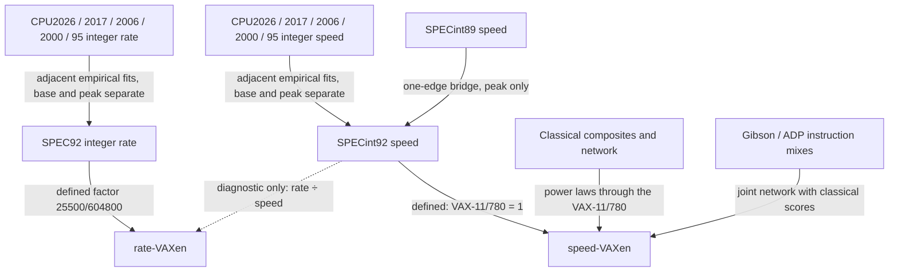

# Research

Updated: 2026-10-03. This directory holds source-checked research results. Each
report below owns one topic; the [model registry](model-registry.json) and its
generated [catalog](catalog.md) record metric identities, datasets, model
dependencies and each document's role. Reports distinguish measured evidence,
derived estimates and open work. Earlier and superseded reports remain in Git
history.

## Reports

| Report | Owns |
| --- | --- |
| [SPEC chains](spec-chains.md) | CPU92–CPU2026 integer rate and speed chains, the VAX rate constant and chain intervals |
| [SPEC sources and audits](spec-sources.md) | Early SPEC archives, the CPU92 rate archive, source-field and execution-resource audits, CPU95/CPU2000 overlap |
| [SPEC89](spec89.md) | Recovered SPEC89 evidence, the SPECint89 → SPECint92 bridge, the joint classical experiment and SPEC89 estimates |
| [Classical fits](classical-fits.md) | Classical/SPEC hardware overlap, direct composites, the sparse network and the power-law sensitivity study |
| [Instruction mixes](instruction-mix.md) | Gibson/ADP inventory and pairing, the mix network and further mix sources |
| [Historical sources](historical-sources.md) | Classical source acquisition, prior work, PDF tables, vendor reports, Usenet lists and early timing evidence |
| [Identity and dates](identity-and-dates.md) | Processor and system resolution, date events, chronology selection, the CPU SKU catalogue and hardware-year evidence |

Machine-readable snapshots are under [`data/`](data/): `spec/`, `spec89/`,
`classic/`, `historical/`, `resource-refresh/` and `timeline/`. The
[classic](data/classic/README.md) and [historical](data/historical/README.md)
guides describe their records. Large raw documents, DocIR, derived tuples and
figures stay outside Git. Original values, citations and qualifications must
survive every conversion; Markdown is not the sole numerical store.

## The VAXen unit

VAXen has two parallel quantities, both setting the VAX-11/780 to 1 (user
decision 2026-10-03). **Rate-VAXen** is its reference throughput under SPEC92
integer rate (`SPECrate_int92 × 25500 / 604800`); **speed-VAXen** is one
SPECint92 point, since the VAX-11/780 is the SPEC92 reference machine. They are
never converted into each other; classical, SPEC89 and mix estimates are
speed-VAXen. The [README](../README.md#the-unit-1-vax) gives the public formula
and [methods](../docs/methods.md#vax-throughput-convention) the full convention.

| Numeric type | Meaning | Interpretation |
| --- | --- | --- |
| Reported suite score | Literal measurement under a named suite, version and mode | Preserve original source and run configuration |
| Normalized observed rate | Reported SPEC92 rate multiplied by the defined constant | The same rate observation in rate-VAXen |
| Observed SPECint92 speed | Reported SPECint92 / SPECbase_int92 | Equal to speed-VAXen by definition |
| Cross-suite estimate | Rate or speed inferred through its own chain's fitted factors | Conditional on matching and calibration population |
| Classical or mix estimate | Power-law calibration of classical scores or mix ratings | Not a measured VAX reference score |
| Manual reconstruction | Workload timing from instructions and hardware assumptions | Planned; separate evidence, not an executed result |

VAXen is a unit; the evidence class belongs to each value. Factor CI95, held-out
P95 and individual prediction intervals are different quantities: a small factor
CI95 does not imply a small error for an individual historical system.

## How the routes connect



The graph shows logical relationships, not statistical independence; the
registry records fitted direction and dependencies. SPEC89 estimates are
inferred targets and cannot validate themselves as SPECint92 measurements, and
the classical→SPEC89 route is supported only for the available intersections.
Composed estimates inherit upstream uncertainty, and shared data or calibration
factors prevent treating all paths as independent.

1. Read [SPEC chains](spec-chains.md) for the modern calibration both quantities
   rest on.
2. [SPEC89](spec89.md) extends speed back to 1987–1991 through one edge.
3. [Classical fits](classical-fits.md) and [instruction mixes](instruction-mix.md)
   extend it to machines with only Dhrystone, Whetstone, LINPACK or mix ratings.
   Benchmark publication date and the age of tested hardware are distinct:
   classical workloads also ran on later machines, which provide overlap rather
   than pre-SPEC evidence by themselves.
4. [Identity and dates](identity-and-dates.md) explains which results are the
   same machine and which year each is plotted at.

Earlier-machine reconstruction (SIMH execution plus trace-based timing) remains
planned; emulator wall time is not hardware execution time. The
[machine watchlist](../docs/machine-watchlist.md) lists priority systems.

## Timeline export

`cpushowspeed plot timeline` combines the saved calibrations with the database
results; the [timeline contract](../docs/timeline.md) owns the record schema,
filters and page. It performs no fitting, scaling by processor count or
residual-based source selection. The [compact audit](data/timeline/unified-audit.json)
records counts and input/code hashes of the current export (`vaxen-timeline-v4`,
2026-10-03):

| Rows | Quantity | Records |
| --- | --- | ---: |
| SPEC92–2026 rate, base and peak | rate | 58,813 |
| SPEC92–2026 speed, base and peak | speed | 40,248 |
| Classical results (one processor or unknown count) | speed | 2,239 |
| SPEC89 bridge estimates | speed | 188 |
| Gibson / ADP mix and combined mixes | speed | 546 |
| **Total** | | **102,034** |

Every record has a unique ID and a positive finite value inside its CI95. The
full-population Node test reproduces CPU2017 rate, CPU92/CPU95/CPU2006/CPU2026
speed, SPEC89, a multi-score classical row, a Gibson row and a two-rating
combined mix through the offline calculator (relative error below 1e-6). The
removed speed/rate joint rows and the former name-merged historical timeline
are in Git history.

## Role and status

Role (primary, control, diagnostic, evidence, archive or planned) describes how
a result is used; status (defined, implemented-conditional, recorded, retired or
planned) describes what exists. Neither is assigned from residual size alone.
Source breadth, hardware coverage and transparent limitations matter alongside
prediction error.

## Registry maintenance

After adding a metric, data source or analysis, update the registry, then run:

```sh
uv run --no-sync cpushowspeed research validate
uv run --no-sync cpushowspeed research render
```

Validation checks IDs, references, dependency cycles, registered document
coverage and required local paths. Derived paths can be absent in a fresh
checkout and are marked optional. Validation does not certify source accuracy,
metric equivalence or statistical independence; `render --check` detects a
stale catalog.
