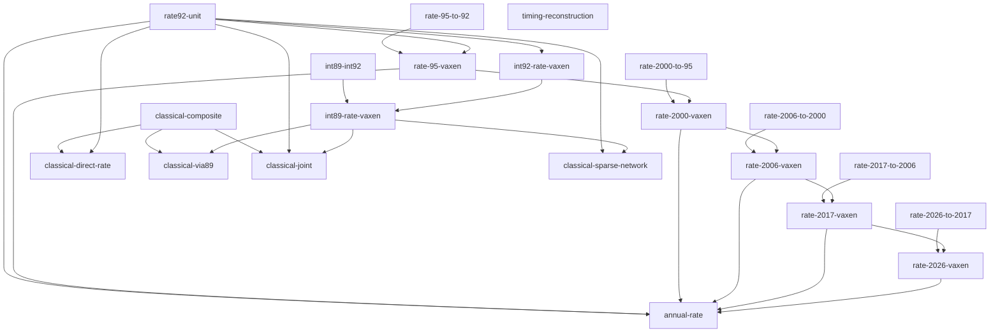

# Research catalog

Generated from [model-registry.json](model-registry.json); edit the registry and run
`cpushowspeed research render`. Paths in the JSON are relative to the repository root.
Start with the [four-track overview](overview.md).

## Metrics

| ID | Meaning | Mode / unit | Status |
| --- | --- | --- | --- |
| vaxen | VAX-11/780 equivalent SPEC92 integer-rate throughput | rate / VAXen | defined |
| rate-92 | SPEC CPU92 integer rate | rate / CPU92 raw integer-rate points | recorded |
| rate-95 | SPEC CPU95 integer rate | rate / CPU95 raw integer-rate points | recorded |
| rate-2000 | SPEC CPU2000 integer rate | rate / CPU2000 raw integer-rate points | recorded |
| rate-2006 | SPEC CPU2006 integer rate | rate / CPU2006 raw integer-rate points | recorded |
| rate-2017 | SPEC CPU2017 integer rate | rate / CPU2017 raw integer-rate points | recorded |
| rate-2026 | SPEC CPU2026 integer rate | rate / CPU2026 raw integer-rate points | recorded |
| int89 | SPECint89 | speed / raw SPECint89 points | recorded |
| int92 | SPECint92 | speed / raw SPECint92 points | recorded |
| base-int92 | SPECbase_int92 | speed / raw SPECbase_int92 points | recorded |
| mark89 | SPECmark89 mixed suite | mixed-speed / raw SPECmark89 mixed suite points | recorded |
| fp89 | SPECfp89 | speed-fp / raw SPECfp89 points | recorded |
| fp92 | SPECfp92 | speed-fp / raw SPECfp92 points | recorded |
| rate-fp92 | SPECrate_fp92 | rate-fp / raw SPECrate_fp92 points | recorded |
| throughput89 | SPECthruput89 | legacy-throughput / raw SPECthruput89 points | recorded |
| retired-spec-speed | Later SPEC integer-speed scores | speed / suite-specific raw points | retired |
| dhry-11 | Dhrystone 1.1 | classical / DMIPS | recorded |
| dhry-21 | Dhrystone 2.1 | classical / DMIPS | recorded |
| dhry-unknown | Dhrystone unknown | classical / source-labelled iterations/time | recorded |
| whet-native | Whetstone native | classical / MWIPS | recorded |
| whet-sp | Whetstone SP | classical / MWIPS | recorded |
| whet-dp | Whetstone DP | classical / MWIPS | recorded |
| linpack-100 | LINPACK n=100 | classical / MFLOPS | recorded |
| linpack-300 | LINPACK n=300 | classical / MFLOPS | recorded |
| linpack-unknown | LINPACK n=unknown | classical / MFLOPS | recorded |
| composite | Fixed equal-weight classical pair/triple index | derived-index / dimensionless geometric index | defined |
| gibson | Gibson instruction mix | historical-lead / source/workload dependent | recorded |
| adp | ADP instruction mix | historical-lead / source/workload dependent | recorded |
| process-control | Process Control mix | historical-lead / source/workload dependent | planned |
| coprxx | COPRXX leads | historical-lead / source/workload dependent | planned |
| coremark | CoreMark | historical-lead / source/workload dependent | planned |
| trace-timing | Assembly trace plus documented timing | historical-lead / source/workload dependent | planned |

## Model relationships

Arrows below express calculation dependencies. Shared datasets and source lineage
are recorded separately in the JSON; edges do not establish independence.

| Model / owner | Inputs → target | Relationship; role; status | Dependencies |
| --- | --- | --- | --- |
| [rate92-unit](../docs/methods.md) | rate-92 → vaxen | definition; primary; defined | none |
| [rate-95-to-92](../research/spec95-spec2026-rate-fitting.md) | rate-95 → rate-92 | empirical-fit; primary; implemented-conditional | none |
| [rate-95-vaxen](../research/spec95-spec2026-rate-fitting.md) | rate-95 → vaxen | composition; primary; implemented-conditional | rate-95-to-92, rate92-unit |
| [rate-2000-to-95](../research/spec95-spec2026-rate-fitting.md) | rate-2000 → rate-95 | empirical-fit; primary; implemented-conditional | none |
| [rate-2000-vaxen](../research/spec95-spec2026-rate-fitting.md) | rate-2000 → vaxen | composition; primary; implemented-conditional | rate-2000-to-95, rate-95-vaxen |
| [rate-2006-to-2000](../research/spec95-spec2026-rate-fitting.md) | rate-2006 → rate-2000 | empirical-fit; primary; implemented-conditional | none |
| [rate-2006-vaxen](../research/spec95-spec2026-rate-fitting.md) | rate-2006 → vaxen | composition; primary; implemented-conditional | rate-2006-to-2000, rate-2000-vaxen |
| [rate-2017-to-2006](../research/spec95-spec2026-rate-fitting.md) | rate-2017 → rate-2006 | empirical-fit; primary; implemented-conditional | none |
| [rate-2017-vaxen](../research/spec95-spec2026-rate-fitting.md) | rate-2017 → vaxen | composition; primary; implemented-conditional | rate-2017-to-2006, rate-2006-vaxen |
| [rate-2026-to-2017](../research/spec95-spec2026-rate-fitting.md) | rate-2026 → rate-2017 | empirical-fit; primary; implemented-conditional | none |
| [rate-2026-vaxen](../research/spec95-spec2026-rate-fitting.md) | rate-2026 → vaxen | composition; primary; implemented-conditional | rate-2026-to-2017, rate-2017-vaxen |
| [annual-rate](../research/annual-rate-vaxen.md) | rate-92, rate-95, rate-2000, rate-2006, rate-2017, rate-2026 → vaxen | aggregation; primary; implemented-conditional | rate92-unit, rate-95-vaxen, rate-2000-vaxen, rate-2006-vaxen, rate-2017-vaxen, rate-2026-vaxen |
| [int89-int92](../research/spec89-rate-bridge.md) | int89 → int92 | empirical-fit; primary; implemented-conditional | none |
| [int92-rate-vaxen](../research/spec89-rate-bridge.md) | int92 → vaxen | empirical-fit; primary; implemented-conditional | rate92-unit |
| [int89-rate-vaxen](../research/spec89-rate-bridge.md) | int89 → vaxen | composition; primary; implemented-conditional | int89-int92, int92-rate-vaxen |
| [classical-composite](../docs/methods.md) | dhry-11, dhry-21, whet-native, whet-sp, whet-dp, linpack-100 → composite | definition; primary; defined | none |
| [classical-direct-rate](../research/classic-rate-composite-fitting.md) | composite → vaxen | empirical-fit; primary; implemented-conditional | classical-composite, rate92-unit |
| [classical-via89](../research/spec89-rate-bridge.md) | composite → vaxen | composition; primary; implemented-conditional | classical-composite, int89-rate-vaxen |
| [classical-joint](../research/spec89-rate-bridge.md) | composite → vaxen | joint-fit; primary; implemented-conditional | classical-composite, rate92-unit, int89-rate-vaxen |
| [timing-reconstruction](../docs/methods.md) | gibson, adp, process-control, trace-timing → vaxen | planned; planned; planned | none |
| [classical-sparse-network](../research/classic-network-fitting.md) | dhry-11, dhry-21, whet-native, whet-sp, whet-dp, linpack-100 → vaxen | joint-fit; primary; implemented-conditional | rate92-unit, int89-rate-vaxen |

## Datasets

| ID | Owner | Path | Availability |
| --- | --- | --- | --- |
| modern-rate-inputs | [guide](../docs/spec-collection.md) | `data/derived/spec` | optional derived input |
| modern-factor-snapshots | [guide](../research/spec95-spec2026-rate-fitting.md) | `research/data/spec/fitting` | required in checkout |
| spec89-snapshot | [guide](../research/spec89-curated-snapshot.md) | `research/data/spec89/v2.0.0` | required in checkout |
| spec89-native-bridge | [guide](../research/spec89-cpu92-scatter.md) | `research/data/spec89/v2.0.0/csv/bridges89_92.csv` | required in checkout |
| spec89-supplement | [guide](../research/spec89-helman-worksheet.md) | `research/data/spec89/aggregate89-plus-helman.csv` | required in checkout |
| spec89-years | [guide](../research/spec89-hardware-years.md) | `research/data/spec89/hardware-introductions.csv` | required in checkout |
| classic-acquisition | [guide](../research/classic-benchmark-collection.md) | `research/data/classic/acquisition.csv` | required in checkout |
| classic-pdf-tables | [guide](../research/classic-pdf-extraction.md) | `research/data/classic/pdf-extraction/tables.jsonl` | required in checkout |
| classic-unit-policy | [guide](../docs/classic-collection.md) | `research/data/classic/pdf-extraction/interpretation-policy.json` | required in checkout |
| classic-overlap | [guide](../research/classic-spec-overlap.md) | `data/derived/classic/overlap-spec` | optional derived input |
| classic-source-pairs | [guide](../docs/classic-collection.md) | `data/derived/classic/source-pair-fit/pairs.csv` | optional derived input |
| classic-source-vectors | [guide](../docs/classic-collection.md) | `data/derived/classic/source-pair-fit/vectors.jsonl` | optional derived input |
| historical-observations | [guide](../research/early-benchmark-evidence.md) | `research/data/historical` | required in checkout |
| maintenance-inventory | [guide](../research/cleanup-inventory.md) | `research/data/maintenance` | required in checkout |
| historical-timeline-years | [guide](../research/historical-vaxen-timeline.md) | `research/data/historical/timeline-year-overrides.csv` | required in checkout |
| hardware-date-events | [guide](../research/hardware-year-evidence.md) | `research/data/historical/hardware-date-evidence.csv` | required in checkout |
| cpu-sku-chronology | [guide](../research/cpu-sku-chronology.md) | `research/data/historical/cpu-sku-chronology.csv` | required in checkout |
| instruction-mix-study | [guide](../research/instruction-mix-bridge.md) | `research/data/classic/mix-study` | required in checkout |
| spec95-2000-overlap-audit | [guide](../research/spec95-spec2000-overlap-audit.md) | `research/data/spec/95-2000-audit` | required in checkout |

## Document inventory

Reports stay at their existing paths to preserve citations. Role distinguishes current
analysis from evidence, diagnostics and retired work.

| Document | Role | Status |
| --- | --- | --- |
| [CPUShowSpeed — Agent guide](../AGENTS.md) | guide | current |
| [CPUShowSpeed](../README.md) | guide | current |
| [Documentation index](../docs/README.md) | guide | current |
| [Research roadmap](../docs/TODO.md) | guide | current |
| [Classic benchmark source collection](../docs/classic-collection.md) | guide | current |
| [Data contract](../docs/data-contract.md) | guide | current |
| [Data schema design](../docs/data-schema.md) | guide | current |
| [Historical document IR (selected design)](../docs/docir.md) | guide | current |
| [Document extraction](../docs/document-extraction.md) | guide | current |
| [Image Pool and captioning (selected design)](../docs/image-pool.md) | guide | current |
| [Priority machine watchlist](../docs/machine-watchlist.md) | guide | current |
| [Research methods](../docs/methods.md) | guide | current |
| [OCR dispatch](../docs/ocr-dispatch.md) | guide | current |
| [Scope and metrics](../docs/scope-and-metrics.md) | guide | current |
| [Candidate sources and acquisition policy](../docs/sources.md) | guide | current |
| [SPEC integer-rate collection and fitting](../docs/spec-collection.md) | guide | current |
| [Research index](../research/README.md) | guide | current |
| [Annual SPEC integer-rate VAXen view](../research/annual-rate-vaxen.md) | primary | current |
| [Annual VAXen view of dated SPEC integer-speed evidence](../research/annual-vaxen-timeline.md) | archive | retired |
| [Historical analyses](../research/archive/README.md) | guide | current |
| [Research catalog](../research/catalog.md) | guide | current |
| [Chandra sample: *A General-Purpose Time-Sharing System*](../research/chandra-timesharing-sample.md) | evidence | current |
| [Classic benchmark source acquisition](../research/classic-benchmark-collection.md) | evidence | current |
| [Three-source PDF extraction completed](../research/classic-pdf-extraction.md) | evidence | current |
| [Direct classical composites to SPEC92 integer-rate VAXen](../research/classic-rate-composite-fitting.md) | primary | current |
| [Additional classical/SPEC sources and prior work](../research/classic-spec-literature.md) | evidence | current |
| [Classical benchmark / SPEC89-92 hardware overlap: first pass](../research/classic-spec-overlap.md) | diagnostic | current |
| [CPU92–CPU95 integer-speed overlap audit](../research/cpu92-cpu95-bridge.md) | archive | retired |
| [Classic collection and overlap snapshots](../research/data/classic/README.md) | guide | current |
| [DEC, SSCL and Tomari/Hiraki table extraction](../research/data/classic/pdf-extraction/README.md) | guide | current |
| [Curated historical observations](../research/data/historical/README.md) | guide | current |
| [Helman SPEC89 worksheet derivative (1991-03-31)](../research/data/spec89/helman-1991/README.md) | guide | current |
| [SPEC89 recovered observations, curated v2.0.0 snapshot](../research/data/spec89/v2.0.0/README.md) | guide | current |
| [First local early-benchmark evidence pass](../research/early-benchmark-evidence.md) | evidence | current |
| [Research overview](../research/overview.md) | guide | current |
| [Locating early SPEC CPU results](../research/spec-early-archives.md) | evidence | current |
| [Cross-generation SPEC entity resolution precedents](../research/spec-entity-resolution.md) | archive | retired |
| [Why Xeon Platinum 8280 is absent from the annual speed leader list](../research/spec2017-8280-speed-rate.md) | archive | retired |
| [SPEC89–CPU92 source-paired scatter](../research/spec89-cpu92-scatter.md) | evidence | current |
| [Curated SPEC89 recovery snapshot](../research/spec89-curated-snapshot.md) | evidence | current |
| [SPEC89 hardware introduction-year audit](../research/spec89-hardware-years.md) | evidence | current |
| [Helman's 1991 SPEC89 worksheet derivative](../research/spec89-helman-worksheet.md) | evidence | current |
| [SPECint89 bridge to SPEC92 rate and joint classical fitting](../research/spec89-rate-bridge.md) | primary | current |
| [SPEC CPU92 integer-rate archive expansion](../research/spec92-archive-expansion.md) | evidence | current |
| [First SPEC92 VAXen figure](../research/spec92-vaxen.md) | archive | retired |
| [Exploratory SPEC CPU92–CPU2026 integer-rate fitting](../research/spec95-spec2026-rate-fitting.md) | primary | current |
| [Track 4 — Classical benchmarks and pre-SPEC extension](../research/tracks/classical.md) | guide | current |
| [Track 2 — SPEC92 through SPEC2026 integer rate](../research/tracks/spec-rate.md) | guide | current |
| [Track 3 — SPEC89 scavenging and rate bridge](../research/tracks/spec89.md) | guide | current |
| [Track 1 — VAXen reference and numeric types](../research/tracks/vaxen.md) | guide | current |
| [Cleanup inventory](../research/cleanup-inventory.md) | diagnostic | current |
| [Schema-driven cleanup inventory](../research/schema-cleanup-inventory.md) | evidence | current |
| [Maintenance inventory snapshot](../research/data/maintenance/README.md) | diagnostic | current |
| [Calibration cleanup and unified validation policy](../research/calibration-cleanup.md) | guide | current |
| [Sparse joint calibration of individual classical benchmarks](../research/classic-network-fitting.md) | primary | current |
| [Predict SPEC92 integer rate from classical scores](../docs/classical-prediction.md) | guide | current |
| [Classical and SPEC89 historical VAXen timeline](../research/historical-vaxen-timeline.md) | primary | current |
| [Hardware-year evidence: bitsavers discovery and first review](../research/hardware-year-evidence.md) | evidence | current |
| [CPU SKU release chronology](../research/cpu-sku-chronology.md) | evidence | current |
| [Shared VAXen timeline](../docs/timeline.md) | guide | current |
| [Unified historical and SPEC rate timeline](../research/unified-vaxen-timeline.md) | primary | current |
| [Gibson and ADP evidence and calibration experiments](../research/instruction-mix-bridge.md) | primary | current |
| [SPEC95/CPU2000 overlap-loss audit](../research/spec95-spec2000-overlap-audit.md) | primary | current |
| [SPEC source fields and execution-resource audit](../research/spec-resource-field-audit.md) | primary | current |
| [Shared benchmark input contract](../docs/input-catalog.md) | guide | current |
| [Shared input migration and fitting review](../research/input-unification-fitting-review.md) | primary | current |
