# Research catalog

Generated from [model-registry.json](model-registry.json); edit the registry and run
`cpushowspeed research render`. Paths in the JSON are relative to the repository root.
Start with the [research index](README.md).

## Metrics

| ID | Meaning | Mode / unit | Status |
| --- | --- | --- | --- |
| vaxen | VAX-11/780 equivalent SPEC92 integer-rate throughput | rate / VAXen | defined |
| speed-vaxen | VAX-11/780 equivalent SPEC92 integer speed | speed / speed-VAXen | defined |
| rate-92 | SPEC CPU92 integer rate | rate / CPU92 raw integer-rate points | recorded |
| rate-95 | SPEC CPU95 integer rate | rate / CPU95 raw integer-rate points | recorded |
| rate-2000 | SPEC CPU2000 integer rate | rate / CPU2000 raw integer-rate points | recorded |
| rate-2006 | SPEC CPU2006 integer rate | rate / CPU2006 raw integer-rate points | recorded |
| rate-2017 | SPEC CPU2017 integer rate | rate / CPU2017 raw integer-rate points | recorded |
| rate-2026 | SPEC CPU2026 integer rate | rate / CPU2026 raw integer-rate points | recorded |
| int89 | SPECint89 | speed / raw SPECint89 points | recorded |
| int92 | SPECint92 | speed / raw SPECint92 points | recorded |
| base-int92 | SPECbase_int92 | speed / raw SPECbase_int92 points | recorded |
| mark89 | SPECmark89 mixed suite | mixed-speed / raw SPECmark89 mixed suite points | recorded |
| fp89 | SPECfp89 | speed-fp / raw SPECfp89 points | recorded |
| fp92 | SPECfp92 | speed-fp / raw SPECfp92 points | recorded |
| rate-fp92 | SPECrate_fp92 | rate-fp / raw SPECrate_fp92 points | recorded |
| throughput89 | SPECthruput89 | legacy-throughput / raw SPECthruput89 points | recorded |
| speed-95 | SPEC CPU95 integer speed | speed / CPU95 raw integer-speed points | recorded |
| speed-2000 | SPEC CPU2000 integer speed | speed / CPU2000 raw integer-speed points | recorded |
| speed-2006 | SPEC CPU2006 integer speed | speed / CPU2006 raw integer-speed points | recorded |
| speed-2017 | SPEC CPU2017 integer speed | speed / CPU2017 raw integer-speed points | recorded |
| speed-2026 | SPEC CPU2026 integer speed | speed / CPU2026 raw integer-speed points | recorded |
| dhry-11 | Dhrystone 1.1 | classical / DMIPS | recorded |
| dhry-21 | Dhrystone 2.1 | classical / DMIPS | recorded |
| dhry-unknown | Dhrystone unknown | classical / source-labelled iterations/time | recorded |
| whet-native | Whetstone native | classical / MWIPS | recorded |
| whet-sp | Whetstone SP | classical / MWIPS | recorded |
| whet-dp | Whetstone DP | classical / MWIPS | recorded |
| linpack-100 | LINPACK n=100 | classical / MFLOPS | recorded |
| livermore-72 | Livermore Fortran Kernels, 72 samples | classical / MFLOPS | recorded |
| linpack-300 | LINPACK n=300 | classical / MFLOPS | recorded |
| linpack-unknown | LINPACK n=unknown | classical / MFLOPS | recorded |
| composite | Fixed equal-weight classical pair/triple index | derived-index / dimensionless geometric index | defined |
| gibson | Gibson instruction mix | historical-lead / source/workload dependent | recorded |
| adp | ADP instruction mix | historical-lead / source/workload dependent | recorded |
| process-control | Process Control mix | historical-lead / source/workload dependent | planned |
| coprxx | COPRXX leads | historical-lead / source/workload dependent | planned |
| coremark | CoreMark | historical-lead / source/workload dependent | planned |
| trace-timing | Assembly trace plus documented timing | historical-lead / source/workload dependent | planned |

## Model relationships

Arrows below express calculation dependencies. Shared datasets and source lineage
are recorded separately in the JSON; edges do not establish independence.

```mermaid
flowchart TD
    rate92_unit["rate92-unit"]
    rate_95_to_92["rate-95-to-92"]
    rate_95_vaxen["rate-95-vaxen"]
    rate_95_to_92 --> rate_95_vaxen
    rate92_unit --> rate_95_vaxen
    rate_2000_to_95["rate-2000-to-95"]
    rate_2000_vaxen["rate-2000-vaxen"]
    rate_2000_to_95 --> rate_2000_vaxen
    rate_95_vaxen --> rate_2000_vaxen
    rate_2006_to_2000["rate-2006-to-2000"]
    rate_2006_vaxen["rate-2006-vaxen"]
    rate_2006_to_2000 --> rate_2006_vaxen
    rate_2000_vaxen --> rate_2006_vaxen
    rate_2017_to_2006["rate-2017-to-2006"]
    rate_2017_vaxen["rate-2017-vaxen"]
    rate_2017_to_2006 --> rate_2017_vaxen
    rate_2006_vaxen --> rate_2017_vaxen
    rate_2026_to_2017["rate-2026-to-2017"]
    rate_2026_vaxen["rate-2026-vaxen"]
    rate_2026_to_2017 --> rate_2026_vaxen
    rate_2017_vaxen --> rate_2026_vaxen
    int89_int92["int89-int92"]
    int92_rate_vaxen["int92-rate-vaxen"]
    rate92_unit --> int92_rate_vaxen
    int89_speed_vaxen["int89-speed-vaxen"]
    int89_int92 --> int89_speed_vaxen
    int92_speed_vaxen --> int89_speed_vaxen
    classical_composite["classical-composite"]
    classical_direct_speed["classical-direct-speed"]
    classical_composite --> classical_direct_speed
    int92_speed_vaxen --> classical_direct_speed
    classical_via89["classical-via89"]
    classical_composite --> classical_via89
    int89_speed_vaxen --> classical_via89
    classical_joint["classical-joint"]
    classical_composite --> classical_joint
    int92_speed_vaxen --> classical_joint
    int89_speed_vaxen --> classical_joint
    timing_reconstruction["timing-reconstruction"]
    classical_sparse_network["classical-sparse-network"]
    int92_speed_vaxen --> classical_sparse_network
    int89_speed_vaxen --> classical_sparse_network
    classical_power_law_sensitivity["classical-power-law-sensitivity"]
    classical_sparse_network --> classical_power_law_sensitivity
    int89_speed_vaxen --> classical_power_law_sensitivity
    instruction_mix_joint_network["instruction-mix-joint-network"]
    classical_sparse_network --> instruction_mix_joint_network
    int92_speed_vaxen --> instruction_mix_joint_network
    int89_speed_vaxen --> instruction_mix_joint_network
    int92_speed_vaxen["int92-speed-vaxen"]
    speed_95_to_92["speed-95-to-92"]
    speed_95_vaxen["speed-95-vaxen"]
    speed_95_to_92 --> speed_95_vaxen
    int92_speed_vaxen --> speed_95_vaxen
    speed_2000_to_95["speed-2000-to-95"]
    speed_2000_vaxen["speed-2000-vaxen"]
    speed_2000_to_95 --> speed_2000_vaxen
    speed_95_vaxen --> speed_2000_vaxen
    speed_2006_to_2000["speed-2006-to-2000"]
    speed_2006_vaxen["speed-2006-vaxen"]
    speed_2006_to_2000 --> speed_2006_vaxen
    speed_2000_vaxen --> speed_2006_vaxen
    speed_2017_to_2006["speed-2017-to-2006"]
    speed_2017_vaxen["speed-2017-vaxen"]
    speed_2017_to_2006 --> speed_2017_vaxen
    speed_2006_vaxen --> speed_2017_vaxen
    speed_2026_to_2017["speed-2026-to-2017"]
    speed_2026_vaxen["speed-2026-vaxen"]
    speed_2026_to_2017 --> speed_2026_vaxen
    speed_2017_vaxen --> speed_2026_vaxen
```

| Model / owner | Inputs → target | Relationship; role; status | Dependencies |
| --- | --- | --- | --- |
| [rate92-unit](../docs/methods.md) | rate-92 → vaxen | definition; primary; defined | none |
| [rate-95-to-92](../research/spec-chains.md) | rate-95 → rate-92 | empirical-fit; primary; implemented-conditional | none |
| [rate-95-vaxen](../research/spec-chains.md) | rate-95 → vaxen | composition; primary; implemented-conditional | rate-95-to-92, rate92-unit |
| [rate-2000-to-95](../research/spec-chains.md) | rate-2000 → rate-95 | empirical-fit; primary; implemented-conditional | none |
| [rate-2000-vaxen](../research/spec-chains.md) | rate-2000 → vaxen | composition; primary; implemented-conditional | rate-2000-to-95, rate-95-vaxen |
| [rate-2006-to-2000](../research/spec-chains.md) | rate-2006 → rate-2000 | empirical-fit; primary; implemented-conditional | none |
| [rate-2006-vaxen](../research/spec-chains.md) | rate-2006 → vaxen | composition; primary; implemented-conditional | rate-2006-to-2000, rate-2000-vaxen |
| [rate-2017-to-2006](../research/spec-chains.md) | rate-2017 → rate-2006 | empirical-fit; primary; implemented-conditional | none |
| [rate-2017-vaxen](../research/spec-chains.md) | rate-2017 → vaxen | composition; primary; implemented-conditional | rate-2017-to-2006, rate-2006-vaxen |
| [rate-2026-to-2017](../research/spec-chains.md) | rate-2026 → rate-2017 | empirical-fit; primary; implemented-conditional | none |
| [rate-2026-vaxen](../research/spec-chains.md) | rate-2026 → vaxen | composition; primary; implemented-conditional | rate-2026-to-2017, rate-2017-vaxen |
| [int89-int92](../research/spec89.md) | int89 → int92 | empirical-fit; primary; implemented-conditional | none |
| [int92-rate-vaxen](../research/spec89.md) | int92 → vaxen | empirical-fit; diagnostic; implemented-conditional | rate92-unit |
| [int89-speed-vaxen](../research/spec89.md) | int89 → speed-vaxen | composition; primary; implemented-conditional | int89-int92, int92-speed-vaxen |
| [classical-composite](../docs/methods.md) | dhry-11, dhry-21, whet-native, whet-sp, whet-dp, linpack-100 → composite | definition; primary; defined | none |
| [classical-direct-speed](../research/classical-fits.md) | composite → speed-vaxen | empirical-fit; primary; implemented-conditional | classical-composite, int92-speed-vaxen |
| [classical-via89](../research/spec89.md) | composite → speed-vaxen | composition; primary; implemented-conditional | classical-composite, int89-speed-vaxen |
| [classical-joint](../research/spec89.md) | composite → speed-vaxen | joint-fit; primary; implemented-conditional | classical-composite, int92-speed-vaxen, int89-speed-vaxen |
| [timing-reconstruction](../docs/methods.md) | gibson, adp, process-control, trace-timing → vaxen | planned; planned; planned | none |
| [classical-sparse-network](../research/classical-fits.md) | dhry-11, dhry-21, whet-native, whet-sp, whet-dp, linpack-100 → speed-vaxen | joint-fit; primary; implemented-conditional | int92-speed-vaxen, int89-speed-vaxen |
| [classical-power-law-sensitivity](../research/classical-fits.md) | dhry-11, dhry-21, whet-native, whet-sp, whet-dp, linpack-100 → speed-vaxen | empirical-fit; diagnostic; implemented-conditional | classical-sparse-network, int89-speed-vaxen |
| [instruction-mix-joint-network](../research/instruction-mix.md) | gibson, adp, dhry-11, dhry-21, whet-native, whet-sp, whet-dp, linpack-100 → speed-vaxen | joint-fit; primary; implemented-conditional | classical-sparse-network, int92-speed-vaxen, int89-speed-vaxen |
| [int92-speed-vaxen](../research/spec-chains.md) | int92 → speed-vaxen | definition; primary; defined | none |
| [speed-95-to-92](../research/spec-chains.md) | speed-95 → int92 | empirical-fit; primary; implemented-conditional | none |
| [speed-95-vaxen](../research/spec-chains.md) | speed-95 → speed-vaxen | composition; primary; implemented-conditional | speed-95-to-92, int92-speed-vaxen |
| [speed-2000-to-95](../research/spec-chains.md) | speed-2000 → speed-95 | empirical-fit; primary; implemented-conditional | none |
| [speed-2000-vaxen](../research/spec-chains.md) | speed-2000 → speed-vaxen | composition; primary; implemented-conditional | speed-2000-to-95, speed-95-vaxen |
| [speed-2006-to-2000](../research/spec-chains.md) | speed-2006 → speed-2000 | empirical-fit; primary; implemented-conditional | none |
| [speed-2006-vaxen](../research/spec-chains.md) | speed-2006 → speed-vaxen | composition; primary; implemented-conditional | speed-2006-to-2000, speed-2000-vaxen |
| [speed-2017-to-2006](../research/spec-chains.md) | speed-2017 → speed-2006 | empirical-fit; primary; implemented-conditional | none |
| [speed-2017-vaxen](../research/spec-chains.md) | speed-2017 → speed-vaxen | composition; primary; implemented-conditional | speed-2017-to-2006, speed-2006-vaxen |
| [speed-2026-to-2017](../research/spec-chains.md) | speed-2026 → speed-2017 | empirical-fit; primary; implemented-conditional | none |
| [speed-2026-vaxen](../research/spec-chains.md) | speed-2026 → speed-vaxen | composition; primary; implemented-conditional | speed-2026-to-2017, speed-2017-vaxen |

## Datasets

| ID | Owner | Path | Availability |
| --- | --- | --- | --- |
| modern-rate-inputs | [guide](../docs/spec-collection.md) | `data/derived/spec` | optional derived input |
| modern-factor-snapshots | [guide](../research/spec-chains.md) | `research/data/spec/fitting` | required in checkout |
| spec89-snapshot | [guide](../research/spec89.md) | `research/data/spec89/v2.0.0` | required in checkout |
| spec89-native-bridge | [guide](../research/spec89.md) | `research/data/spec89/v2.0.0/csv/bridges89_92.csv` | required in checkout |
| spec89-supplement | [guide](../research/spec89.md) | `research/data/spec89/aggregate89-plus-helman.csv` | required in checkout |
| classic-acquisition | [guide](../research/historical-sources.md) | `research/data/classic/acquisition.csv` | required in checkout |
| classic-pdf-tables | [guide](../research/historical-sources.md) | `research/data/classic/pdf-extraction/tables.jsonl` | required in checkout |
| curated-observations | [guide](../docs/data-schema.md) | `data/curated/observation.jsonl` | required in checkout |
| classic-overlap | [guide](../research/classical-fits.md) | `data/derived/classic/parsed-sources` | optional derived input |
| schema-database | [guide](../docs/data-schema.md) | `data/derived/schema/cpushowspeed.sqlite` | optional derived input |
| historical-observations | [guide](../research/historical-sources.md) | `research/data/historical` | required in checkout |
| curated-sources | [guide](../docs/data-schema.md) | `data/curated/source.jsonl` | required in checkout |
| curated-processors | [guide](../research/identity-and-dates.md) | `data/curated/processor_sku.jsonl` | required in checkout |
| processor-mentions | [guide](../research/identity-and-dates.md) | `data/derived/schema/processor-mentions.jsonl` | optional derived input |
| curated-vendors | [guide](../research/identity-and-dates.md) | `data/curated/vendor.jsonl` | required in checkout |
| hardware-records | [guide](../research/identity-and-dates.md) | `data/derived/schema/hardware-records.jsonl` | optional derived input |
| curated-date-events | [guide](../research/identity-and-dates.md) | `data/curated/date_event.jsonl` | required in checkout |
| result-records | [guide](../research/identity-and-dates.md) | `data/derived/schema/result-records.jsonl` | optional derived input |
| instruction-mix-study | [guide](../research/instruction-mix.md) | `research/data/classic/mix-study` | required in checkout |
| spec95-2000-overlap-audit | [guide](../research/spec-sources.md) | `research/data/spec/95-2000-audit` | required in checkout |
| mix-network | [guide](../research/instruction-mix.md) | `research/data/classic/mix-network-coefficients.csv` | required in checkout |
| modern-speed-chain | [guide](../research/spec-chains.md) | `research/data/spec/fitting/integer-speed-chain-intervals.csv` | required in checkout |

## Document inventory

Role distinguishes current analysis from evidence, diagnostics and guides.

| Document | Role | Status |
| --- | --- | --- |
| [CPUShowSpeed — Agent guide](../AGENTS.md) | guide | current |
| [CPUShowSpeed](../README.md) | guide | current |
| [Documentation index](../docs/README.md) | guide | current |
| [Research roadmap](../docs/TODO.md) | guide | current |
| [Classic benchmark source collection](../docs/classic-collection.md) | guide | current |
| [Classical benchmark runner (planned design)](../docs/classic-bench.md) | guide | current |
| [Data contract](../docs/data-contract.md) | guide | current |
| [Data schema design](../docs/data-schema.md) | guide | current |
| [Historical document IR (selected design)](../docs/docir.md) | guide | current |
| [Document extraction](../docs/document-extraction.md) | guide | current |
| [Image Pool and captioning (selected design)](../docs/image-pool.md) | guide | current |
| [Priority machine watchlist](../docs/machine-watchlist.md) | guide | current |
| [Research methods](../docs/methods.md) | guide | current |
| [OCR dispatch](../docs/ocr-dispatch.md) | guide | current |
| [Scope and metrics](../docs/scope-and-metrics.md) | guide | current |
| [Candidate sources and acquisition policy](../docs/sources.md) | guide | current |
| [SPEC integer-rate collection and fitting](../docs/spec-collection.md) | guide | current |
| [Predict SPEC92 integer rate from classical scores](../docs/classical-prediction.md) | guide | current |
| [Shared VAXen timeline](../docs/timeline.md) | guide | current |
| [Shared benchmark input contract](../docs/input-catalog.md) | guide | current |
| [Research](../research/README.md) | guide | current |
| [Research catalog](../research/catalog.md) | guide | current |
| [SPEC92–2026 integer rate and speed chains](../research/spec-chains.md) | primary | current |
| [SPEC sources and audits](../research/spec-sources.md) | evidence | current |
| [SPEC89 recovery and bridge](../research/spec89.md) | primary | current |
| [Classical benchmark calibration](../research/classical-fits.md) | primary | current |
| [Gibson and ADP instruction mixes](../research/instruction-mix.md) | primary | current |
| [Historical benchmark sources](../research/historical-sources.md) | evidence | current |
| [Identity resolution and dates](../research/identity-and-dates.md) | evidence | current |
| [Classic collection and overlap snapshots](../research/data/classic/README.md) | guide | current |
| [DEC, SSCL and Tomari/Hiraki table extraction](../research/data/classic/pdf-extraction/README.md) | guide | current |
| [Curated historical observations](../research/data/historical/README.md) | guide | current |
| [Helman SPEC89 worksheet derivative (1991-03-31)](../research/data/spec89/helman-1991/README.md) | guide | current |
| [SPEC89 recovered observations, curated v2.0.0 snapshot](../research/data/spec89/v2.0.0/README.md) | guide | current |
