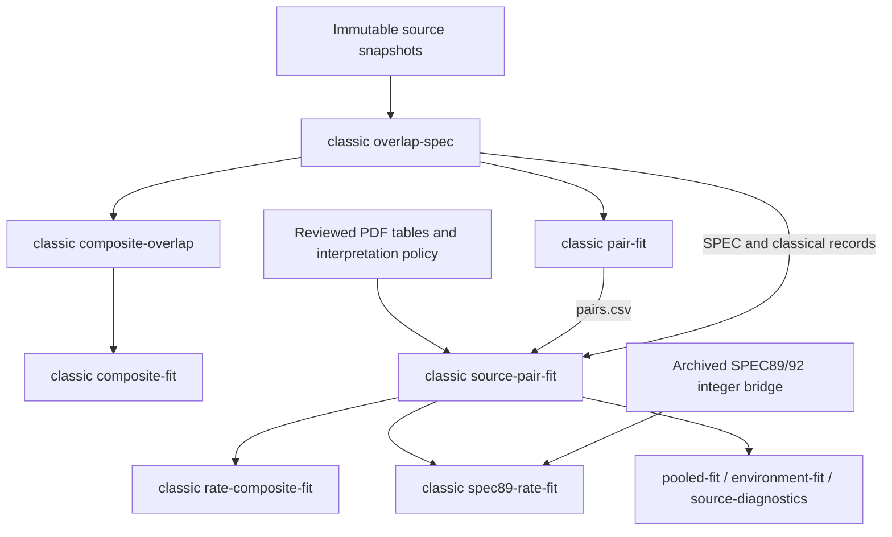

# Cleanup inventory

Inventory date: 2026-09-27. Baseline commit: `d2e4329`.
This is a static inventory, not a refactor or deletion. Scientific calculations,
raw evidence, existing outputs and commands have not been changed in this pass.

Follow-up: [implemented calibration cleanup](calibration-cleanup.md) records
shared modules, unified errors, preparation commands and verified artifact removal.
The inventory below remains the baseline assessment.

## Scope and evidence

Inspected all 39 Python modules in `python-src/cpushowspeed/`, collecting 92
package import statements and 41 decorated command entry points. Top-level
function bodies were compared structurally using Python AST without locations;
three exact-body groups were found. Similar statistical implementations were
also read manually. Exact-body equality alone does not prove identical API or
I/O semantics. Dynamic imports and constructed filesystem paths require review.

The filesystem inventory covers 47 entries: individual children under
`data/derived/classic/` plus the other top-level derived areas. Sizes are logical
file bytes, not allocated disk blocks. Producer/consumer entries identify known
relationships, not an exhaustive proof that other readers do not exist.
No artifact has passed an isolated end-to-end rebuild-and-remove trial.

Machine-readable evidence is under [data/maintenance](data/maintenance/README.md).
The current measurements and source paths, rather than filename age, determine
which items can be consolidated or removed.

## 1. Repeated code and safe consolidation boundaries

| Priority | Finding | Proposed cleanup | Required preservation |
| --- | --- | --- | --- |
| P1 | `read_csv` in `classic_diagnostics`, `classic_source_fit`, and `csv_rows` in `classic_environment` have identical bodies | Extract a neutral CSV reader | Preserve default encoding/newline behavior; explicitly support BOM where required |
| P1 | `classic_overlap.read_csv` additionally accepts paths and UTF-8 BOM | Reuse the common reader with an explicit encoding contract | Do not silently change archive header interpretation |
| P1 | CSV writers differ: overlap uses first-row fields/LF, classical fit unions fields/CSV default CRLF | Provide declared writer policies | Preserve columns, empty-file behavior, bytes and audit hashes; no global newline rewrite of evidence |
| P1 | `classic_source_fit.fit` calls the reference fit with 100 draws, then replaces its interval with another bootstrap | Separate point/error estimation from resampling | Keep the chosen median grouping, RNG, resample count and numerical tolerance; remove redundant draws only after parity checks |
| P1 | Active rate and SPEC89 models import `composites` from auxiliary `classic_pooled` | Move vector assembly to a neutral module | Exact component identities, complete triangle edges, repeat observations and provenance |
| P2 | Native pooled and two-edge bridge implementations repeat grouping, holdouts and joint bootstrap plumbing | Extract a shared engine with explicit edge definitions | Remove held-out models from every edge; use common draw weights; distinguish observed and inferred targets |
| P2 | Plot functions repeat grids, log axes, labels, interval bands and export | Extract small rendering helpers | Preserve plot-specific evidence labels, interval meanings and empty-cohort panels |
| P3 | SHA-256 helpers in annual rate, rate chain and input validation are exact-body duplicates; OCR/caption timestamp helpers likewise | Consolidate opportunistically | No need to alter unrelated processing pipelines just to eliminate tiny helpers |

### Statistical differences that must remain explicit

- Classical default fits use model medians; the modern chain has its own
  system/processor-configuration grouping. These are not interchangeable weights.
- `classic_fit.quantile` interpolates order statistics. Environment evaluation
  uses a weighted-CDF threshold. A shared function name must not erase this distinction.
- Ordinary model bootstrap, native-generation joint bootstrap, and two-edge
  joint bootstrap have different sampling populations and dependence assumptions.
- Model-center P95, maximum within-model P95 and environment-weighted observation
  P95 summarize different errors. Renaming all of them `p95_error` would lose meaning.
- Modern chain intervals use named random streams and an audited cross-edge
  assumption. They should not be replaced with the classical bootstrap by convenience.

A suitable first extraction is neutral I/O and classical composite construction,
then point estimation/error reporting. Generalizing every statistical experiment
into one framework is not a prerequisite for a useful cleanup.

## 2. Main workflow versus older experiments

### Actual input chain

`source-pair-fit` reads the **tracked reviewed PDF snapshot** by default, not
`data/derived/classic/pdf-tables/`. The latter is an extractor output whose values
must be reviewed/published into the snapshot separately. Deleting an extractor
output does not authorize deleting the reviewed snapshot, recipes or corrections.

### CLI and code dependencies

`cli.py` eagerly imports and registers all current experimental commands.
Deleting an old module without adjusting imports can break the entire CLI,
even if the removed command is never invoked. In addition:

- `classic_rate_composite` imports utilities from `classic_fit`, vector assembly
  from `classic_pooled`, and fitting/I/O from `classic_source_fit`.
- `classic_89_rate` imports the same modules plus identity rules from
  `classic_overlap`.
- `classic_source_fit` imports the original estimator from `classic_fit`;
  `classic_pdf` even imports its CSV writer from that experiment module.
- `pair-fit` currently builds a required downstream dataset and also runs
  optional historical regressions/plots. Data preparation and experimentation
  are coupled in the same command.

Therefore **auxiliary scientific role does not mean removable implementation**.
First split shared helpers and data preparation from experiment commands. Then
consider grouping diagnostic commands separately while retaining compatibility
aliases for documented reproduction commands. No command retirement is approved
by this inventory.

## 3. Generated artifacts and deletion candidates

The observed derived areas occupy approximately 71 MiB classical, 337 MiB
PDF/DocIR, 31 MiB figures, 95 MiB SPEC and 4.7 MiB SPEC89 (allocated-size
inspection; exact logical bytes are in the inventory CSV). Space saving is
modest for classical-only cleanup and is not a reason to risk archaeological evidence.

| Area | Current disposition | Why |
| --- | --- | --- |
| `classic/overlap-spec` | Keep dependency-bearing outputs | Feeds pair construction, source vectors and later fits |
| `classic/pair-fit/pairs.csv` | Keep until preparation is split | Required by source-pair-fit; the whole directory is not obsolete |
| `classic/source-pair-fit/pairs.csv` and `vectors.jsonl` | Keep active inputs | Feed direct rate, SPEC89 bridge and diagnostics |
| `classic/composite-overlap` | Keep if old triple reproduction is retained | Feeds composite-fit |
| `classic/pdf-tables` | Candidate only after snapshot/rebuild comparison | Derived output is not the same object as the tracked reviewed snapshot |
| `classic/fit-spec92`, `composite-fit`, `environment-fit`, `pooled-fit`, `source-diagnostics` | Optional experiment-output candidates | Known producers exist; preserve tracked findings and verify regeneration before removing local products |
| `classic/rate-composite-fit`, `spec89-rate-fit` | Keep latest primary views | Referenced research artifacts and old-hardware estimates |
| `data/derived/documents`, `spec`, `figures`, `spec89` | Retain; coarse inventory only | No file-level obsolescence assessment in this pass |
| `data/raw`, source ZIPs, inventories, recipes, corrections and source-checked snapshots | Preserve | Irreplaceable provenance or user-provided evidence; not disposable because ignored by Git |

There is **no unconditional deletion list yet**. A known producer is not proof
that the original runtime, inputs and policies remain available. The next phase
should rebuild candidates into a separate directory and compare values,
provenance, schemas and the selected numerical tolerances before deleting only
those outputs confirmed redundant. Preserve a current figure set for reader links.

### Existing provenance boundary

The hash check inspected 55 entries in tracked classical audit files. Of these,
54 checks match current bytes and one differs. The two scalar code hashes
were resolved to their defining modules by inspecting the hash-writing code.
No checked input path is missing.

The differing entry is `pooled-audit.json`'s hash for `classic_pooled.py`: the
module has subsequently gained configurable target selection for the rate
experiment. This shows code evolution after the saved audit, not evidence that
source measurements changed or that the historical fit is numerically wrong.
Do not overwrite the old hash just to obtain a clean check. A new reproduction
should generate its own audit and compare numerical results. Historical audit
records and current code validation have distinct purposes.

## Suggested execution order

1. Preserve the committed baseline and choose numerical/schema parity gates
   from existing direct-rate and SPEC89 bridge outputs.
2. Extract CSV policies and composite construction without changing commands.
3. Separate pair/vector preparation from optional experiment fitting/plotting.
4. Consolidate point estimation and plotting where semantics match; keep
   weighted and joint-resampling policies explicit.
5. Clarify diagnostic CLI grouping with compatibility aliases and update the
   registry/reproduction paths.
6. Rebuild selected optional outputs in isolation; produce an exact removable
   file list only after comparison succeeds.

This pass ran static inspections and documentation/registry checks. It did not
rerun the fitting pipeline, modify numerical snapshots or remove artifacts.
