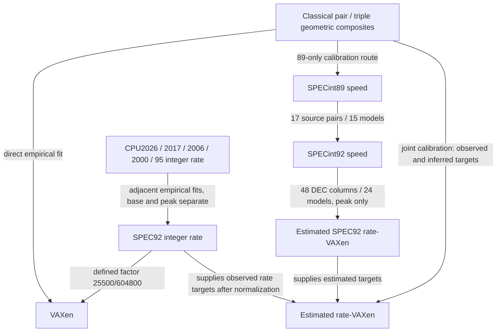

# Research overview

Updated: 2026-09-27. Read the four tracks in order to understand the common
unit, modern calibration, SPEC89 extension and classical workload pivots.

## How the routes connect



The graph shows logical relationships, not statistical independence. The
registry records actual fitted direction and dependencies. In particular,
SPEC89→rate is a two-edge estimate: no directly paired 89/rate machine exists
in the current inventory. Its inferred targets cannot validate themselves as
rate measurements. Classical→SPEC89 is supported only for the available
classical intersections, not for arbitrary early machines.

## Read by track

1. [VAXen reference](tracks/vaxen.md): unit, score types and uncertainty.
2. [Modern integer-rate chain](tracks/spec-rate.md): matching, factors, annual views.
3. [SPEC89 recovery](tracks/spec89.md): sources and the two-edge rate bridge.
4. [Classical extension](tracks/classical.md): direct, indirect and joint routes.

## Find the authoritative detail

- [Model registry](model-registry.json): machine-readable metrics, datasets,
  model dependencies, roles, evidence status and document ownership.
- [Generated catalog](catalog.md): every registered metric/model/document.
- [Methods](../docs/methods.md): common scientific rules and selected decisions.
- Topic reports own numerical conclusions; CSV/JSON snapshots own numerical
  artifacts. The registry points to those artifacts rather than copying fitted
  coefficients into another manually maintained table.
- [Source and diagnostic index](README.md) routes to supporting work.
- [Historical analyses](archive/README.md) identify superseded speed-era reports.

## Read uncertainty and status together

A definition has no fitted sampling error. Empirical fits have conditional
factor intervals. Composed estimates inherit upstream uncertainty; shared data
or calibration factors prevent treating all paths as independent. A small
factor CI95 does not imply a small error for an individual historical system.

Role (primary, control, diagnostic, evidence, archive or planned) describes
how a result is used. Status (defined, implemented-conditional, recorded,
retired or planned) describes what exists. Neither is assigned solely from
residual size. Source breadth, hardware coverage and transparent limitations
matter alongside prediction error.

## Registry maintenance

After adding a metric, data source or analysis, update the registry, then run:

```sh
uv run --no-sync cpushowspeed research validate
uv run --no-sync cpushowspeed research render
```

Validation checks IDs, references, dependency cycles, registered document
coverage and required local paths. Derived paths can be absent in a fresh
checkout and are identified as optional. Validation does not certify source
accuracy, metric equivalence or statistical independence. The generated catalog
must be regenerated when the registry changes; `render --check` detects drift.
